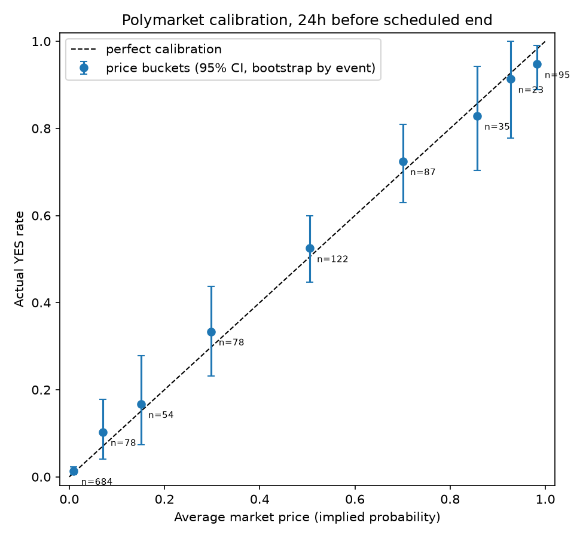
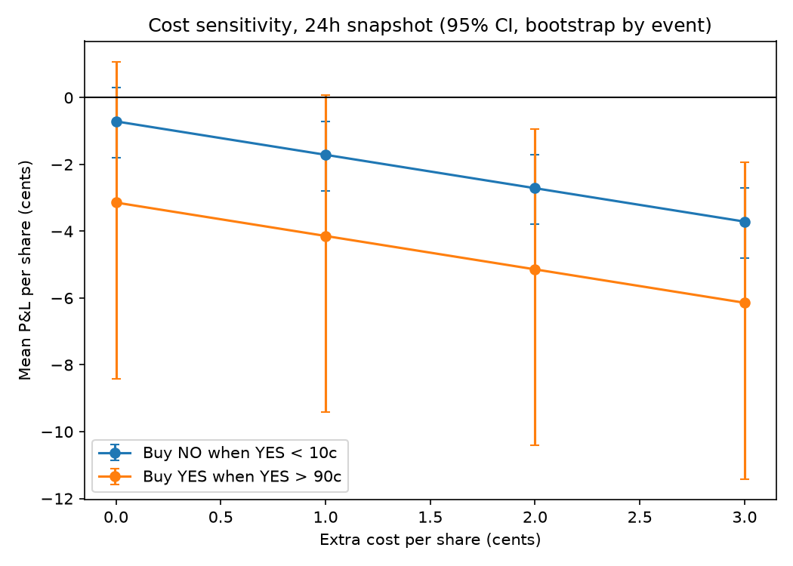
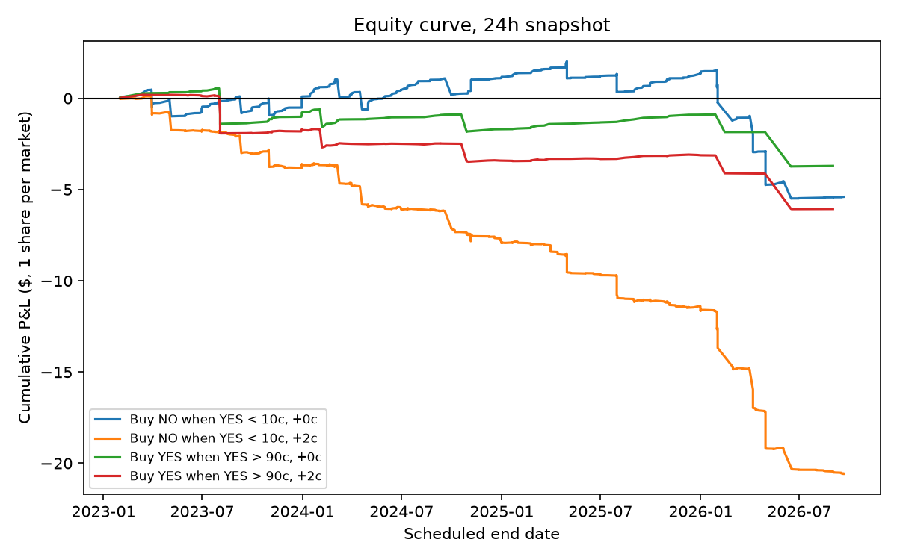

# Are Polymarket prices right? Calibration and favourite-longshot bias

I measured how accurate Polymarket prices are on ~1,900 resolved binary markets, tested whether cheap "longshot" contracts are mispriced, backtested a strategy built on that idea, and checked whether a recalibration model can beat the raw price.

## Summary

- **Prices were well calibrated.** One day before a market's scheduled end, the average price in every bucket fell inside its 95% interval (Brier 0.078, versus 0.190 for always predicting the base rate).
- **No favourite-longshot bias was detectable.** Contracts priced under 10¢ resolved YES 2.2% of the time at 24h against 1.5% implied by price, and 1.9% against 2.0% at 7d. Neither gap is distinguishable from zero.
- **The strategy has no edge.** "Buy NO when YES < 10¢" earns -0.7¢ per share before costs at 24h (95% CI -1.8 to +0.3) and +0.1¢ at 7d (-1.0 to +1.1). With 1-2¢ of extra cost it is significantly negative.
- **A recalibration model did not help.** Walk-forward on later markets, it tied or lost to the raw price.

A negative result, stated plainly.

## Key charts

| Calibration (24h)                           | Cost sensitivity (24h)                    | Equity curve (24h)                |
| ------------------------------------------- | ----------------------------------------- | --------------------------------- |
|  |  |  |

## Data and method

- **Sources:** Polymarket Gamma API (market metadata, outcomes, event tags) and CLOB API (hourly YES-token price history). Public, no login.
- **Sample:** the 50 highest-volume resolved binary YES/NO markets per scheduled-end month, Jan 2023 to Sep 2026, minimum $5,000 volume. 2,242 markets seen, 1,897 kept (282 not Yes/No, 58 duplicates, 3 cancelled or 50-50, 2 unparseable). They belong to 1,063 events.
- **Outcome:** YES = 1 if the final YES price was at least 0.99.
- **Snapshot rule (point in time):** price = last hourly price at or before `scheduled end date - horizon`, at 24h and 7d. A market counts only if it was already created and still open at the snapshot. This leaves 1,256 markets (818 events) at 24h and 1,143 (703 events) at 7d.
- **Why the scheduled end date and not the close time:** close time depends on the outcome ("by date" markets that resolve YES close early). In a 99-market test, 8 of 9 early closers were YES against 37% of the rest, so using close time leaks the outcome.
- **Uncertainty:** bootstrap that resamples whole events, not rows, because markets in one event are correlated. Exact (Clopper-Pearson) intervals for buckets with 0% or 100% YES, where the bootstrap collapses.
- **Categories:** from event tags, then keywords on the question, then merged where thin. Crude; "Other" is 8.4% of usable markets.

## Results

### Calibration

All 9 price buckets at 24h have an average price inside the exact 95% interval for the YES rate. Example buckets (24h):

| Bucket  | n   | Avg price | YES rate | Exact 95% interval |
| ------- | --- | --------- | -------- | ------------------ |
| 0-5¢    | 684 | 0.9%      | 1.3%     | 0.5% to 2.9%       |
| 5-10¢   | 78  | 7.1%      | 10.3%    | 4.1% to 19.3%      |
| 95-100¢ | 95  | 98.3%     | 94.7%    | 88.3% to 98.7%     |

At 7d, one bucket (20-40¢) leans above its price (+9.7¢ by bootstrap) and sits at the edge of its exact interval. With 18 intervals tested, one borderline result is expected by chance.

Brier by year: 0.068 (2023), 0.063 (2024), 0.070 (2025), 0.136 (2026). About half of the 2026 gap is category mix (Sports is 35% of 2026 markets, and Sports are near coin flips); excluding Sports, 2026 is 0.097 with an interval overlapping other years. The rest comes from a cluster of Geopolitics surprises (Iran-related), priced at 1% or less a day before they resolved YES.

### Strategy backtest

One share per market, held to resolution. P&L per share in cents, with 95% event-bootstrap intervals:

| Rule                   | Horizon | Before costs         | +1¢ cost             | +2¢ cost              |
| ---------------------- | ------- | -------------------- | -------------------- | --------------------- |
| Buy NO when YES < 10¢  | 24h     | -0.71 (-1.80, +0.29) | -1.71 (-2.80, -0.71) | -2.71 (-3.80, -1.71)  |
| Buy NO when YES < 10¢  | 7d      | +0.08 (-1.02, +1.10) | -0.92 (-2.02, +0.10) | -1.92 (-3.02, -0.90)  |
| Buy YES when YES > 90¢ | 24h     | -3.14 (-8.41, +1.07) | -4.14 (-9.41, +0.07) | -5.14 (-10.41, -0.93) |
| Buy YES when YES > 90¢ | 7d      | 0.00 (-4.67, +3.13)  | -1.00 (-5.67, +2.13) | -2.00 (-6.67, +1.13)  |

- No rule has a gross edge distinguishable from zero.
- The 24h "NO < 10¢" result comes from a few events: the five worst losses are -$4.94 of a -$5.40 total.
- The only positive-looking variant (7d, YES > 95¢) has zero losses in 59 trades. Its tight interval is an artefact of having nothing to resample, and a single loss (about -98¢) would wipe out its total profit.
- A flat extra cost is harsh on markets priced near 0¢ or 100¢, where the possible gain is under 1¢. The cost table is a conservative bound.

### Recalibration model

Logistic regression on logit(price), then adding market age and category, then (deliberately leaky) final volume. Walk-forward by quarter from 2024Q1, expanding window, trained only on markets resolved before each test quarter. Difference in Brier score, model minus market (negative = model better):

| Model                  | 24h                        | 7d                         |
| ---------------------- | -------------------------- | -------------------------- |
| Recalibrate price only | +0.0005 (-0.0000, +0.0009) | +0.0009 (+0.0001, +0.0017) |
| + age, category        | +0.0027 (+0.0009, +0.0046) | +0.0020 (-0.0008, +0.0051) |
| + final volume (leaky) | +0.0049 (+0.0020, +0.0079) | +0.0019 (-0.0028, +0.0065) |

The market was already well calibrated; the models added nothing out of sample, and the extra features overfit.

## Validation

- Hand check of two markets (Fed rate cut by March 20, 2024; Iran x Israel/US conflict ends by April 7, 2026): the stored snapshot price equals the raw CLOB price, and both match the polymarket.com chart to rounding. This is a spot check, not a full audit.

## Limitations

- Prices come from price history, not executable bid/ask. Costs are handled with a sensitivity table, not modelled.
- Fees changed over time (43% of 2026 markets have fees enabled, against under 1% in 2025). I did not verify the fee formula.
- Choosing the top markets by final volume is a mild lookahead.
- Markets in one event are correlated. Markets about the same real-world story sit under different events, so the bootstrap is too optimistic for 2026.
- Results apply to markets still open one day before their scheduled end. 30% of markets had already closed by then and are excluded. The scheduled end date is sometimes loose (the Iran market kept trading about two weeks past it).
- About 10 rule and horizon combinations were tested, and some rules were added after seeing the calibration tables. Treat the older-versus-newer-half split as the real test.
- Categories are rule-based and tags were fetched in 2026.

## How to run (Windows PowerShell)

```powershell
python -m venv .venv; .venv\Scripts\Activate.ps1
pip install -r requirements.txt
python src\fetch.py markets --start 2023-01-01 --end 2026-10-01 --per-window 50
python src\fetch.py snapshots
python src\fetch.py events
python src\analysis.py
python src\backtest.py
python src\model.py
```
